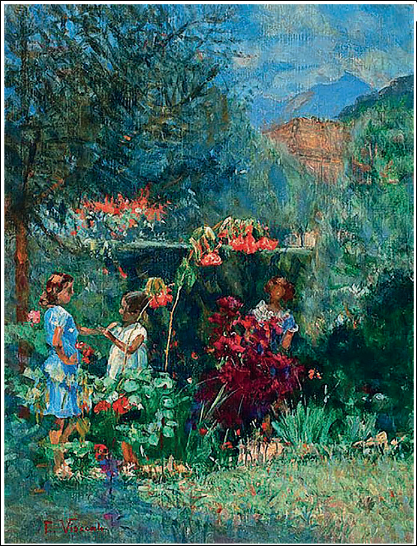

VISCONTI, E. Três meninas no jardim. Óleo sobre tela, 81 × 65 cm. Museu Nacional de Belas Artes, Rio de Janeiro, 1935.

Eliseu D’Angelo Visconti (1866-1944) desenvolveu diversas obras no Brasil, com grande influência das escolas europeias. Em sua pintura _Três meninas no jardim_, há:
