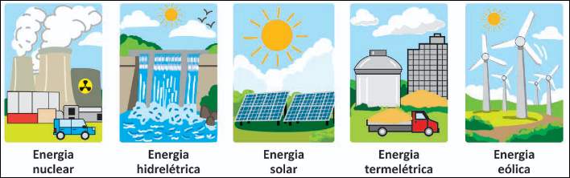

A busca por fontes alternativas de energia é uma das grandes preocupações da humanidade devido ao possível esgotamento dos combustíveis fósseis e à degradação ambiental causada por eles. Como a demanda de energia cresce significativamente, há um grande investimento em outros tipos de geração de energia, tais como hidrelétrica, nuclear, solar, termelétrica a biomassa e eólica.

Dentre as fontes de energia citadas, o tipo de energia oriunda de uma fonte não renovável, que independe das condições climáticas para ser obtida, é a:
